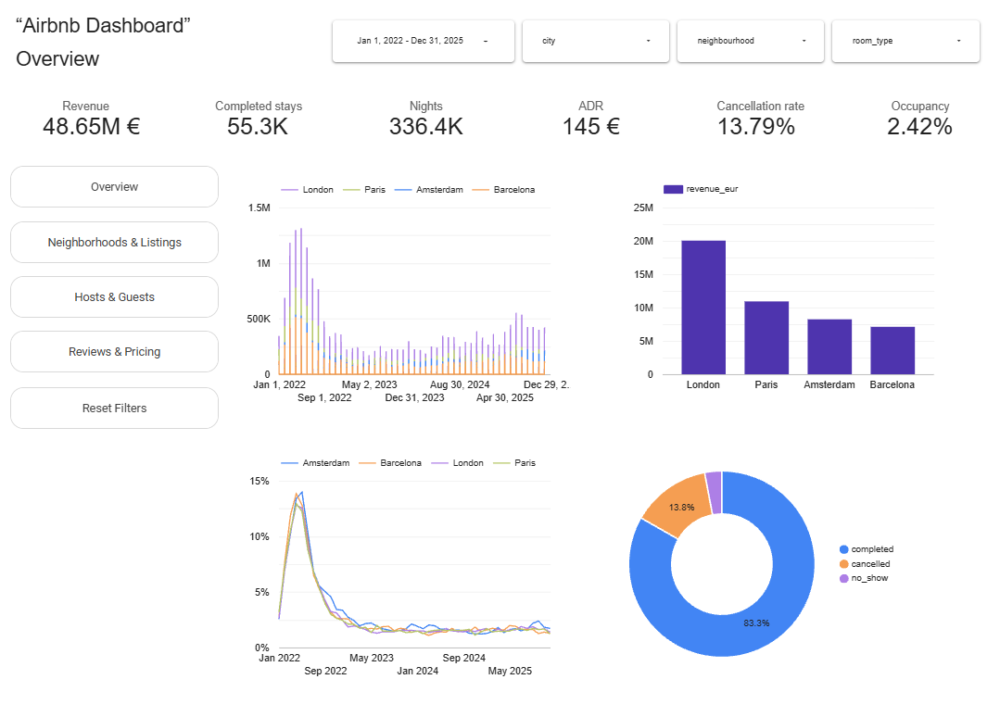
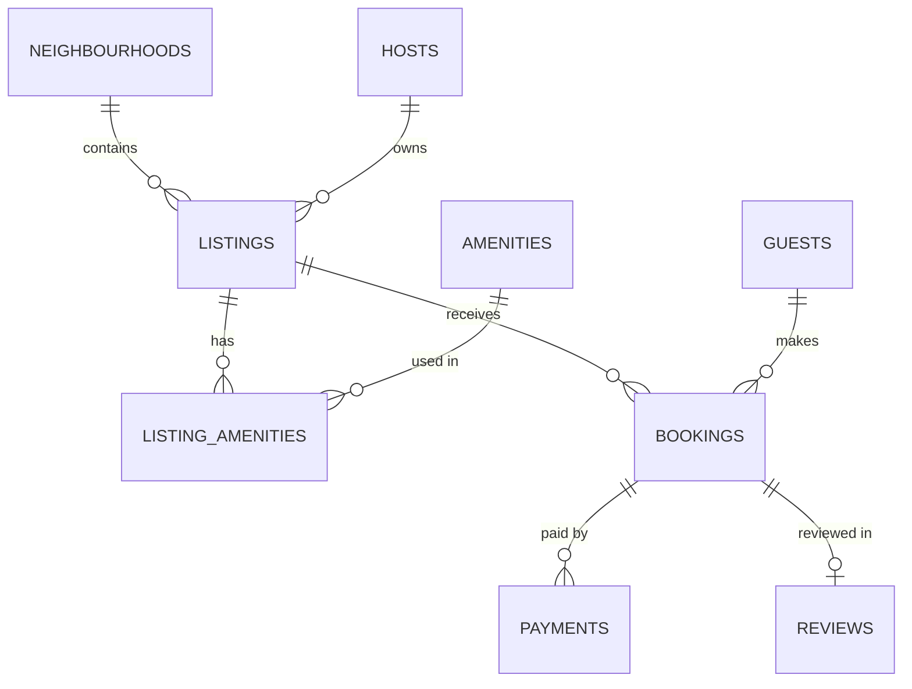
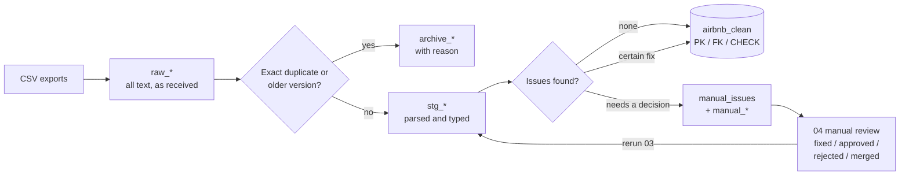
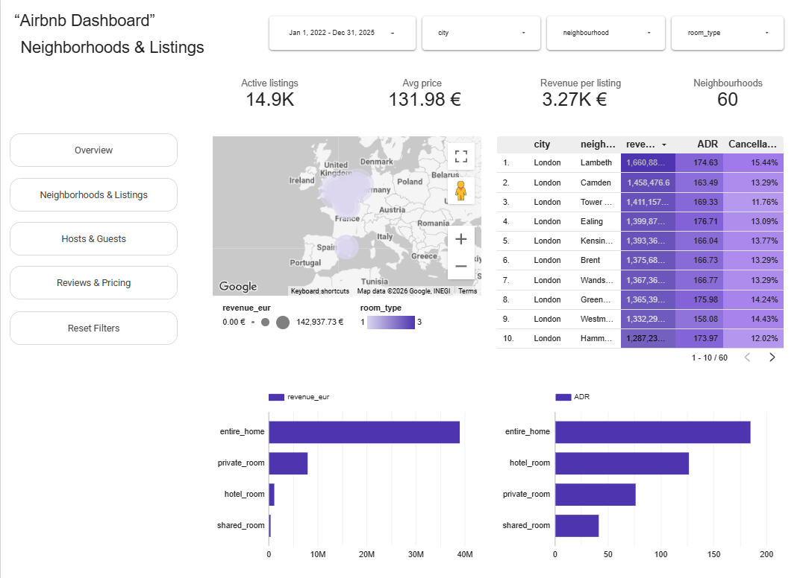
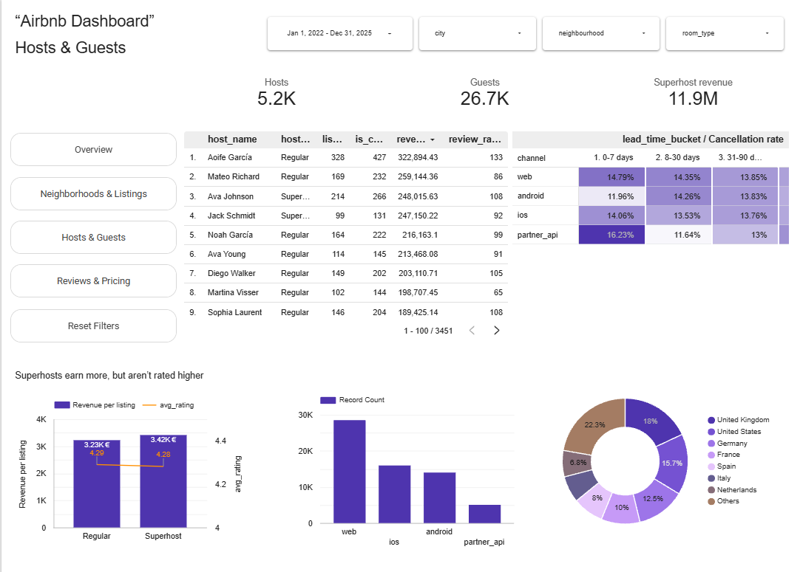
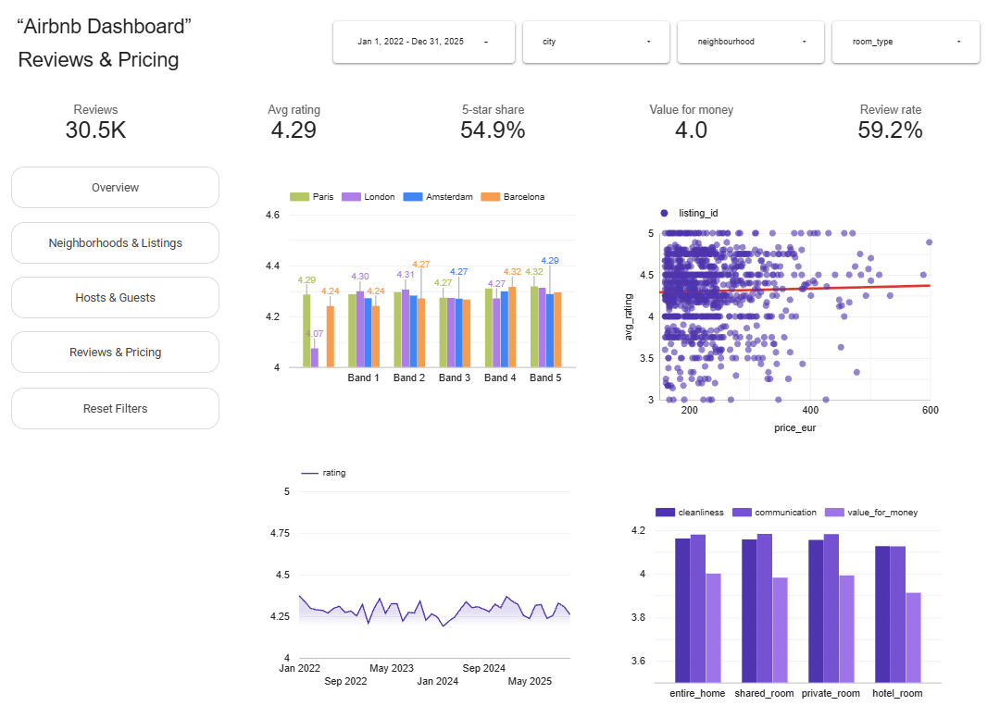

<h1 align="center">Airbnb Performance Report</h1>
<p align="center">London · Paris · Barcelona · Amsterdam &nbsp;|&nbsp; MySQL 8.0 · Looker Studio</p>

<div align="center">
<table>
<tr>
<td>

<h2>Company Background</h2>

The company runs an Airbnb-style short-term rental marketplace in four European cities: London (GBP), Paris, Barcelona and Amsterdam (EUR). It connects hosts with guests and takes bookings through its website, iOS and Android apps and a partner API.

As the business grew, booking, payment and review data started coming from several systems, and the reports built on it stopped agreeing with each other. Dates, prices and categories were entered in different formats, and duplicate and broken records crept in. The operations team needed clean, trustworthy data, a clear view of where revenue comes from and what drives guest satisfaction, and a dashboard the Head of Operations can use every week.

<h3>Northstar Metrics</h3>

<h4>

- **Revenue and demand:** revenue, completed stays, nights, ADR and occupancy by city and month
- **Neighbourhoods and listings:** which areas and room types earn the most
- **Hosts and guests:** Superhost performance, booking channels, cancellations and lead time
- **Reviews and pricing:** whether a higher price leads to a better-rated stay

</h4>

</td>
</tr>
</table>
</div>

# Executive Summary

### Revenue and Bookings (2022–2025)



<table>
<tr>
<td width="50%" valign="top">

**1. Overall Performance**
- **€48.65M** revenue from **55.3K** completed stays and **336.4K** nights.
- Average daily rate (ADR) of **€145**.
- **13.79%** of bookings are cancelled, 83.3% complete and the rest are no-shows.

**2. Peak and Decline**
- 2022 was the strongest year at about **€21M**, 43% of all revenue in the period.
- Revenue fell to about €6.6M in 2023, as occupancy dropped from a spring 2022 peak of around 14% to about 2%.

</td>
<td width="50%" valign="top">

**3. Recovery**
- Revenue grew again in 2024 (€7.8M) and 2025 (€10.9M), about **+40%** year on year in 2025.

**4. Key Takeaways**
- **London** brings in the most revenue (about €20M, over 40% of the total), followed by Paris (€10.9M), Amsterdam (€8.2M) and Barcelona (€7.1M).
- **Entire homes** drive about 80% of revenue.
- Superhosts earn more per listing but are **not** rated higher, and paying more does **not** buy a better-rated stay.

</td>
</tr>
</table>

## Dataset Structure and ERD (Entity Relationship Diagram)



| Table | Rows received | Description |
|---|---:|---|
| neighbourhoods | 64 | neighbourhood, city, country, centre coordinates |
| hosts | 8,322 | host profile, Superhost flag, response rate |
| guests | 35,809 | guest profile, country, signup date |
| listings | 15,755 | property and room type, price, capacity, location, status |
| amenities | 85 | amenity dictionary |
| listing_amenities | 61,513 | listing ↔ amenity link table |
| bookings | 68,651 | booking and stay dates, guests, price, status, channel |
| payments | 77,718 | deposits, balances, failed attempts, refunds |
| reviews | 34,239 | overall rating, cleanliness, communication, value, comment |
| **Total** | **302,156** | |

# Data Cleaning

The exports were in bad shape. Before I could trust a single revenue number, I had to deal with:

- **Dates** in a dozen formats: `2024/03/15`, `15-Mar-2024`, `March 15, 2024`, `20240315`, Excel serials, unix epochs, ISO with time zones
- **Money stored as text**: `£120.00`, `EUR 99.50`, `1.234,50`, `(55.00)` for negatives, and `$` signs on GBP/EUR bookings
- **Category typos**: `Entire_Home`, `Apartmnt`, `canceled`, `andriod`, `Pay Pal`, `Holland`
- **Null tokens** (`N/A`, `null`, `None`, `-`, `nan`), phone numbers in every format, `&amp;` and `café` in text
- **Duplicates**: exact copies, older versions of hosts and listings, the same guest with two accounts
- **Broken business rules**: overlapping bookings, check-out before check-in, totals that don't add up, reviews written before the stay, orphan foreign keys

### How the pipeline works

I kept two databases. `airbnb_raw` holds the data exactly as received, plus the archive and review tables. `airbnb_clean` only gets rows that pass every check.



**1. Load everything as text (`01`).** Every raw column is VARCHAR/TEXT, so values like `£120` or `03/04/2024` load without errors and the original value is always there to check against.

**2. Archive, don't delete (`03`).** Exact duplicate rows and superseded versions (same id, older `updated_at`) are moved to `archive_<table>` with a reason. Nothing disappears without a trace.

| Table | Archive reason | Rows |
|---|---|---:|
| listings | superseded_version | 600 |
| hosts | superseded_version | 240 |
| listing_amenities | exact_duplicate | 610 |
| bookings | exact_duplicate | 546 |
| payments | exact_duplicate | 540 |
| guests | exact_duplicate | 284 |
| reviews | exact_duplicate | 271 |
| listings | exact_duplicate | 125 |
| hosts | exact_duplicate | 82 |
| listing_amenities | duplicate_after_mapping | 19 |
| amenities | duplicate_dictionary_entry | 5 |
| **Total** | | **3,322** |

**3. Parse into staging (`03`).** I wrote 14 stored functions that take a messy text value and return a typed one, or NULL when the value isn't certain. Category spellings go through a mapping table (`Apartmnt`, `Flat` → `apartment`). For example, the date parser handles every format it can read safely and refuses to guess on ambiguous slash dates:

```sql
-- 25/12/2024 is clearly DD/MM, 12/25/2024 is clearly MM/DD, 03/04/2024 is ambiguous
IF a > 12 THEN SET dd = a; SET mm = b;
ELSEIF b > 12 THEN SET mm = a; SET dd = b;
ELSEIF a = b THEN SET dd = a; SET mm = b;
ELSE RETURN NULL;          -- ambiguous, left for manual review
END IF;
```

**4. Log every issue (`03`).** Each check writes one row per problem to `manual_issues`, with a severity that decides what happens to the row:

| Severity | What happens | Example | Issues |
|---|---|---|---:|
| hold | row stays out of clean until someone decides | ambiguous booking date, overlapping booking, orphan host | 7,310 |
| null_value | row loads, the bad value becomes NULL | invalid email, rating out of 1–5, review before check-out | 5,038 |
| keep_value | row loads as is, flagged for information | email shared by two guests | 2,091 |
| waiting | row is fine, but its parent row is on hold | payment for a held booking | 13,880 |

The biggest problems by table on the first run:

| Table | Top issues (rows held) |
|---|---|
| bookings | ambiguous date (889), `$` vs GBP/EUR (731), orphan listing or guest (549), total doesn't match (405), check-out before check-in (206), overlapping booking (135) |
| payments | ambiguous date (405), `$` vs GBP/EUR (338), orphan booking (333), paid before booked (245), amount doesn't reconcile (234), reused transaction ref (230) |
| guests | probable duplicate person (512) |
| listings | points to a duplicate neighbourhood (307), orphan host or neighbourhood (95), conflicting duplicate (60) |
| reviews | listing or guest doesn't match the booking (239), second review for a booking (101), junk/test text (70) |

**5. Manual review (`04`).** Rows on hold are copied to `manual_<table>` with a `review_status` column. I resolve them as `fixed`, `approved`, `rejected` or `merged`. I only bulk-fix a row when other data backs the fix up. For example, for an ambiguous check-in date I try all four DD/MM and MM/DD combinations and keep the one where `nights × rate + fee` equals the booking total. If more than one fits, the row stays open.

```sql
UPDATE manual_bookings m
JOIN ( ... all 4 date readings per booking ...
       WHERE DATEDIFF(x.co, x.ci) * c.rate + c.fee = c.total
       GROUP BY c.raw_row_id
       HAVING COUNT(*) = 1 ) r ON r.raw_row_id = m.raw_row_id
SET m.check_in = r.new_ci, m.check_out = r.new_co,
    m.review_status = 'fixed', m.reviewer_note = 'date order chosen so the total adds up';
```

What the review resolved:

| Fix | Evidence | Rows |
|---|---|---:|
| Booking dates reordered | only one reading makes the total add up | 870 |
| `$` treated as a typo (bookings, listings, payments) | the amount matches the booking total or payments | 1,082 |
| Guest accounts merged | same person with a second account | 512 |
| Booking total recomputed | matches what was actually paid | 293 |
| Booking status filled in | inferred from payments and reviews | 265 |
| Check-in and check-out swapped back | dates were reversed | 205 |
| Payment date reading chosen | only one reading falls after the booking date | 157 |
| 10-point review scores halved | score was out of 10 | 143 |
| Price or rate divided by 100 | ×100 typo, matches bookings | 78 |
| Second and junk reviews rejected | duplicate review or test text | 161 |
| Duplicate neighbourhoods merged | same name and centre | 4 |

**6. Rerun and reconcile (`03`).** After review I rerun 03. It re-checks every `fixed` and `approved` row and loads the ones that now pass. Anything that still fails goes back to `open` with my edits kept. The last step checks that every raw row is accounted for: raw = archived + clean + held + resolved.

| Table | Rows received | Archived | In clean (before review) | In clean (after review) | Still held |
|---|---:|---:|---:|---:|---:|
| neighbourhoods | 64 | 0 | 60 | 60 | 0 |
| hosts | 8,322 | 322 | 8,000 | 8,000 | 0 |
| guests | 35,809 | 284 | 35,013 | 35,013 | 0 |
| amenities | 85 | 5 | 80 | 80 | 0 |
| listings | 15,755 | 725 | 14,569 | 14,875 | 155 |
| listing_amenities | 61,513 | 629 | 58,789 | 60,011 | 873 |
| bookings | 68,651 | 546 | 62,186 | 66,507 | 1,597 |
| payments | 77,718 | 540 | 68,805 | 74,059 | 3,118 |
| reviews | 34,239 | 271 | 30,654 | 32,747 | 1,060 |
| **Total** | **302,156** | **3,322** | **278,156** | **291,352** | **6,803** |

Most of the rows still held are waiting on a parent row (for example, payments for a booking that's still on hold) or are judgement calls such as overlapping bookings, which I left for the operations team to decide.

### Scripts

| Script | What it does |
|---|---|
| `00_setup_and_checks.sql` | Turns on `local_infile` and checks the load |
| `01_raw_schema_and_load.sql` | Creates `airbnb_raw` with text columns and bulk-loads the CSVs |
| `02_clean_schema.sql` | Creates `airbnb_clean`: 11 typed tables with primary keys, foreign keys, CHECK constraints and country/city lookups |
| `03_cleaning_pipeline.sql` | Archive, parse, log issues, build the manual queue, load clean, reconcile. Rerunnable, about 2.5 minutes |
| `04_manual_review.sql` | Review queries and evidence-backed fixes for the `manual_*` tables |
| `05_analytics.sql` | 14 business questions on the clean data (CTEs, window functions, recursive calendar) |
| `06_export_clean_data.sql` / `.bat` | Reporting views (`rpt_*`), money converted to EUR, CSV export to `Clean_data` for Looker Studio |

# Insights Deep-Dive

# Neighbourhoods & Listings



<table>
<tr>
<td width="50%" valign="top">

**Listings and Price**
1. **14.9K** listings across **60** neighbourhoods.
   - Average nightly price of **€131.98**.
   - Average revenue per listing of **€3.27K**.
2. London holds all of the top 10 neighbourhoods by revenue.
   - **Lambeth** leads with about **€1.66M**, followed by Camden (€1.46M) and Tower Hamlets (€1.41M).
   - Cancellation rates in the top 10 range from 11.8% (Tower Hamlets) to 15.4% (Lambeth).

</td>
<td width="50%" valign="top">

**Room Types**
1. **Entire homes** earn close to €40M, about 80% of all revenue.
   - They also have the highest ADR, at about €185 a night.
2. Hotel rooms charge about €127 a night but bring in little revenue.
3. Private rooms (about €76) and shared rooms (about €42) are the budget end of the market.
4. Revenue is concentrated: in every city the **top 20%** of listings earn about **65%** of the revenue.

</td>
</tr>
</table>

# Hosts & Guests



<table>
<tr>
<td width="50%" valign="top">

**Hosts**
1. **5.2K** hosts and **26.7K** guests had bookings in the period.
2. Superhosts made **€11.9M** of the revenue.
3. Superhosts earn about **6% more** per listing (**€3.42K** vs **€3.23K** for regular hosts).
   - But their average rating is **not** higher (4.28 vs 4.29).
4. The top earning host, Aoife García, made about €323K from 328 listings.

</td>
<td width="50%" valign="top">

**Guests and Channels**
1. **Web** is the main channel at around 29K bookings, ahead of iOS and Android. Partner API is the smallest.
2. Cancellation rates sit close to 14% everywhere, with one outlier:
   - **Partner API bookings made 0–7 days before arrival cancel the most (16.23%).**
   - Partner API bookings made 8–30 days ahead cancel the least (11.64%).
3. Guests mostly come from the **UK (18%)**, the **US (15.7%)** and **Germany (12.5%)**.

</td>
</tr>
</table>

# Reviews & Pricing



<table>
<tr>
<td width="50%" valign="top">

**Ratings**
1. **30.5K** reviews with an average rating of **4.29**.
   - **54.9%** of reviews are 5 stars.
   - **59.2%** of completed stays get a review.
2. The average rating stayed between about 4.2 and 4.4 every month from 2022 to 2025.
3. **Value for money (4.0)** is the weakest sub-score for every room type, below cleanliness and communication (about 4.15).
   - Hotel rooms score lowest on value.

</td>
<td width="50%" valign="top">

**Price vs Rating**
1. Ratings are almost flat across the five price bands in every city (about 4.24 to 4.32).
2. The price vs rating scatter has a nearly horizontal trendline.
   - **Paying more does not buy a better-rated stay** in this market.

</td>
</tr>
</table>

# Recommendations

#### Based on the insights above, these are the actions I recommend to the operations team.

### Revenue
- **Focus growth on London and entire homes.**
  - London earns over 40% of revenue, and entire homes about 80%.
  - All top 10 neighbourhoods by revenue are in London.
- **Find out why demand dropped after 2022 and keep the 2024–2025 recovery going.**
  - Revenue grew about 40% in 2025 but is still about half of 2022.

### Listings
- **Help the long tail of listings earn more.**
  - The top 20% of listings earn about 65% of revenue, so most listings are underused.
  - Occupancy has been around 2% since mid-2022.

### Hosts
- **Review what the Superhost badge stands for.**
  - Superhosts earn €3.42K per listing vs €3.23K, but are rated the same (4.28 vs 4.29).
  - If the badge is meant to signal a better stay, its criteria should be tied more closely to guest ratings.

### Bookings
- **Tighten last-minute partner API bookings.**
  - Partner API bookings made within a week of arrival cancel at 16.23%, the highest of any channel and lead time.
  - A stricter cancellation policy or deposit for this group would protect revenue.

### Pricing and Reviews
- **Work on value for money, especially for higher-priced and hotel listings.**
  - Value for money is the lowest sub-score (4.0) for every room type.
  - Higher prices don't bring higher ratings, so premium listings need to justify their price.

### Data Quality
- **Fix the problems at the source.**
  - Dates, prices and categories should be validated when they're entered, not cleaned afterwards.
  - About 6.8K rows are still on hold, mostly overlapping bookings and payments that don't reconcile. These need a decision from operations and finance.

# Folder Structure

```
Airbnb/
├── Clean_data/                   rpt_*.csv exports used by the dashboard
├── Dashboard/                    dashboard screenshots (ex01–ex04)
├── 00_setup_and_checks.sql
├── 01_raw_schema_and_load.sql
├── 02_clean_schema.sql
├── 03_cleaning_pipeline.sql
├── 04_manual_review.sql
├── 05_analytics.sql
├── 06_export_clean_data.bat
├── 06_export_clean_data.sql
├── amenities.csv
├── bookings.csv
├── guests.csv
├── hosts.csv
├── listing_amenities.csv
├── listings.csv
├── neighbourhoods.csv
├── payments.csv
├── reviews.csv
└── README.md
```

# How to Run

Windows, MySQL 8.0, Command Prompt (not PowerShell), from the folder above. Change the CSV paths in the `LOAD DATA` lines of `01_raw_schema_and_load.sql` to your own folder first.

```
mysql -u root -p -e "SET GLOBAL local_infile = 1;"
mysql --local-infile=1 --default-character-set=utf8mb4 -u root -p < 01_raw_schema_and_load.sql
mysql --default-character-set=utf8mb4 -u root -p < 02_clean_schema.sql
mysql --default-character-set=utf8mb4 -u root -p < 03_cleaning_pipeline.sql
mysql --default-character-set=utf8mb4 -u root -p < 04_manual_review.sql
mysql --default-character-set=utf8mb4 -u root -p < 03_cleaning_pipeline.sql
mysql --default-character-set=utf8mb4 -u root -p -t < 05_analytics.sql
06_export_clean_data.bat
```

If `mysql` is not on your PATH, use the full path, for example `"C:\Program Files\MySQL\MySQL Server 8.0\bin\mysql.exe"`.

<h3>Author</h3>

<strong>Algirdas Vailionis</strong>, Data Analyst/Scientist · <a href="https://www.linkedin.com/in/algirdas-vailionis/">LinkedIn</a> · <a href="mailto:algirdas.vailionis@gmail.com">Email</a>
